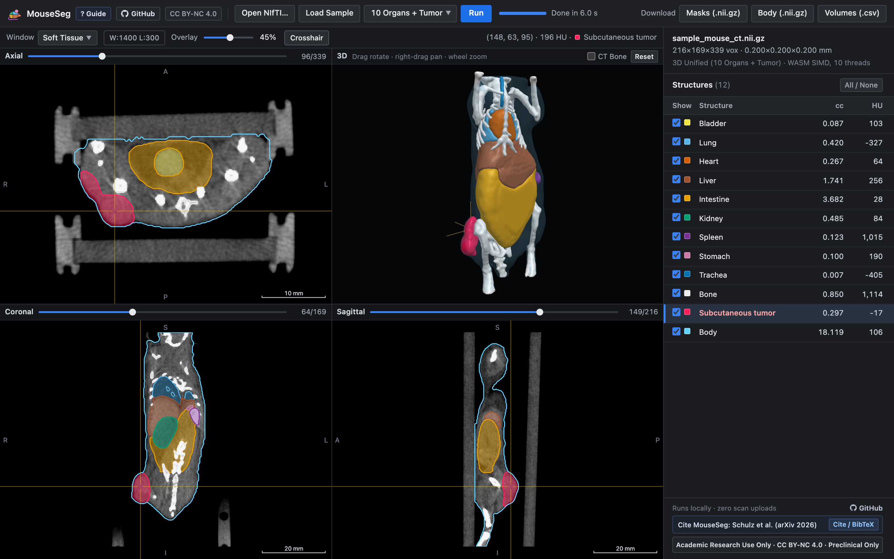
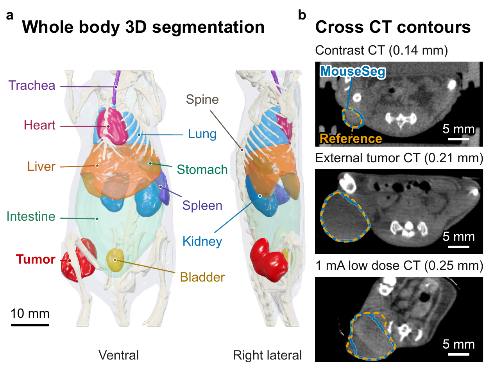
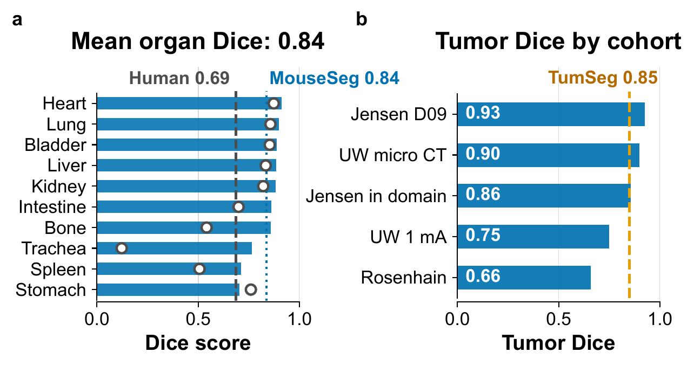
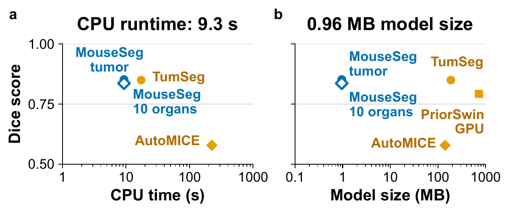
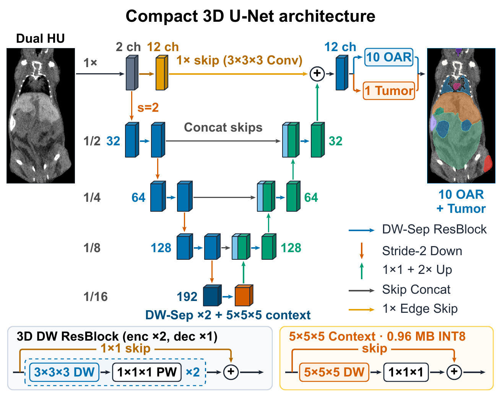

#  MouseSeg

Open-source 3D murine micro-CT and cone-beam CT (CBCT) segmentation of 10 organs at risk (OARs), subcutaneous xenograft and syngeneic tumors, and cradle-stripped whole-body masks in under 10 seconds on standard CPUs. Built as a lightweight Python NIfTI command-line tool (in the style of TotalSegmentator and MOOSE for preclinical small-animal radiotherapy, radiopharmaceutical dosimetry, and oncology imaging) with a companion zero-install WebAssembly browser application.

**Try instantly in your browser (zero install, 100% local):** [https://mouseseg.joeyschulz.com](https://mouseseg.joeyschulz.com)



## Highlights

- **10 mouse organs + subcutaneous tumor + cradle-stripped body mask** in `< 10 s` on a laptop or desktop CPU.
- **Under 1 MB model weights** (`0.96 MB` unified 3D model, `0.94 MB` 3D tumor specialist) included in `models/`.
- **Zero GPU and zero PyTorch required for inference** (`numpy`, `scipy`, `nibabel`, `onnxruntime` only).
- **Scanner-robust CT preprocessing**: automatic RAS orientation standardization, `-400 HU` clipped-air restoration, `0.20 mm` isotropic resampling, soft-tissue HU calibration, and 3D connected-component postprocessing.



## Quickstart (CPU Inference)

```bash
git clone https://github.com/wizrads/MouseSeg.git && cd MouseSeg
pip install -r requirements.txt
```

Segment a mouse micro-CT or cone-beam CT scan (`10` organs + subcutaneous tumor):

```bash
python segment_mouse.py -i mouse_ct.nii.gz -o mouse_seg.nii.gz
```

Export a cradle-stripped whole-mouse body mask and structure volume/HU summary CSV, or run tumor-only mode or batch folder inference:

```bash
# Unified mode + cradle-stripped 0/1 body mask + CSV volume/HU table
python segment_mouse.py -i mouse_ct.nii.gz -o mouse_seg.nii.gz --body-mask mouse_body.nii.gz --csv metrics.csv

# Fast subcutaneous tumor specialist mode
python segment_mouse.py -i mouse_ct.nii.gz -o mouse_tumor.nii.gz --mode tumor_only

# Batch folder of NIfTI scans
python segment_mouse.py -i ./scans_in -o ./masks_out --threads 4
```

## Structure Label IDs

| ID | Structure | Notes |
| :---: | :--- | :--- |
| `1` | Bladder | Urinary bladder |
| `2` | Lung | Bilateral lungs |
| `3` | Heart | Whole heart |
| `4` | Liver | Whole liver |
| `5` | Intestine | Gastrointestinal tract |
| `6` | Kidney | Bilateral kidneys |
| `7` | Spleen | Whole spleen |
| `8` | Stomach | Whole stomach |
| `9` | Trachea | Intrathoracic and cervical airway |
| `10` | Bone | Whole-body skeleton |
| `12` | Subcutaneous tumor | Flank or subcutaneous xenograft/syngeneic tumor |

When `--body-mask` is enabled, MouseSeg also writes a separate binary (`0/1`) whole-mouse body mask with animal beds, cradles, and positioning rails removed.

## Validation & CPU Efficiency

Across 181 unseen public micro-CT, institutional micro-CT, and 1 mA low-dose flat-panel CT scans, the unified 3D model exceeds human interobserver organ agreement (`0.84` vs `0.69` mean 10-organ Dice) while matching published GPU tumor models in `9.3 s` on CPU (`0.96 MB` INT8 weights):





## Fine-Tuning & Training on Your Own Scanner

To adapt MouseSeg to `3–20` labeled scans from your own micro-CT or cone-beam CT scanner (or train a new 3D U-Net from scratch), install the PyTorch training dependencies:

```bash
pip install -r requirements-train.txt
```

Organize matching NIfTI scans and integer label masks by filename stem (`<stem>.nii.gz` or nnU-Net `<stem>_0000.nii.gz` are paired automatically):

```text
my_data/
  images/
    mouse01.nii.gz
    mouse02.nii.gz
  labels/
    mouse01.nii.gz
    mouse02.nii.gz
```

Fine-tune the pretrained MouseSeg weights (`models/mouseseg_unified.pt` or `models/mouseseg_tumor_specialist.pt`) and export a ready-to-use `.onnx` model with embedded preprocessing metadata:

```bash
python finetune.py \
  --images ./my_data/images \
  --labels ./my_data/labels \
  --mode unified \
  --output models/my_scanner_unified.onnx

python segment_mouse.py -i new_scan.nii.gz -o new_seg.nii.gz --model models/my_scanner_unified.onnx
```

Train a Compact 3D U-Net (`mouseseg/model.py`) from scratch:

```bash
python train.py \
  --images ./my_data/images \
  --labels ./my_data/labels \
  --mode unified \
  --epochs 50 \
  --output models/custom_unified.onnx
```



## Citation

If you use MouseSeg in your research, please cite:

```bibtex
@article{schulz2026mouseseg,
  title         = {{MouseSeg}: Open Source 3D Mouse Organ and Tumor {CT} Segmentation in Under 10 Seconds Without {GPUs}},
  author        = {Schulz, Joseph B. and Haasch, Campbell and Kwon, Ohyun and Bednarz, Bryan P.},
  year          = {2026},
  archivePrefix = {arXiv},
  url           = {https://github.com/wizrads/MouseSeg},
  note          = {Web application: https://mouseseg.joeyschulz.com}
}
```

## License & Preclinical Disclaimer

- **License:** Released for **Academic and Non-Commercial Research Use Only** under **[CC BY-NC 4.0](LICENSE)**. Commercial use requires prior written permission. Upstream dataset, teacher model, and library attributions are documented in **[THIRD_PARTY_NOTICES.md](THIRD_PARTY_NOTICES.md)**.
- **Preclinical Research Only:** MouseSeg is strictly intended for preclinical small-animal (murine CT) research. It is not cleared or approved by the FDA or any regulatory agency for human clinical, diagnostic, or treatment-planning use, and is provided "as is" without warranty.
